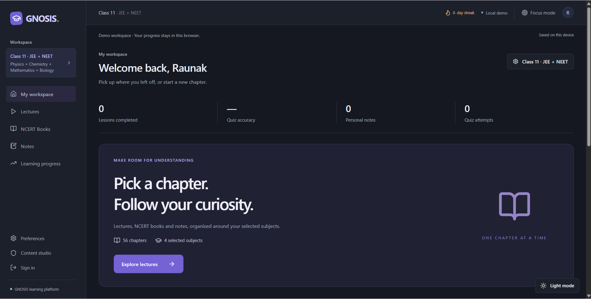

# GNOSIS

## Chapter mock tests (local implementation)

Every Class 11 and 12 lecture chapter uses one shared mock-test engine. Select difficulty first: Easy supports 10 questions, Medium 10/20 and Hard 10/20/30. Duration is calculated at 1/2/3 minutes per question respectively and enforced server-side. Default: Easy, 10. No mixed tests. Only reviewed, verified non-sample content enables new tests.

All current real approved counts are zero. Drafts and development samples remain stored but cannot activate tests, even locally. Open a chapter's lecture and scroll to Mock Test to inspect difficulty, duration and actual approved availability. Guest recovery uses the browser and a private local server directory; durable cloud persistence is not connected. See [mock-test architecture and imports](docs/MOCK-TESTS.md).

## Chapter libraries

The workspace now has **Lectures**, **NCERT Books**, and **Notes**, with separate Class 11 and Class 12 chapter lists. Only selected subjects are shown. Mathematics selects JEE automatically, Biology selects NEET, and selecting both sets JEE + NEET. Each lecture chapter has Detailed and One-shot sections. Four owner-supplied notes PDFs are available for Class 11 Physics chapters 1–4 (108 pages total). Four owner-supplied textbook chapter PDFs are also available for Class 11 Physics chapters 1–4 (70 pages total). Eight supplied YouTube lectures are available for Class 11 Physics chapters 1–4: one Detailed and one One-shot lecture per chapter. Eight supplied lectures are also available for Class 11 Chemistry chapters 1–4: one Detailed and one One-shot per chapter. Six supplied textbook PDFs are available for Class 11 Chemistry chapters 1–6 (220 pages total). Six supplied textbook PDFs are also available for Class 11 Mathematics chapters 1–6 (125 pages total). Four supplied notes PDFs are available for Class 11 Chemistry chapters 1–4 (197 pages), using clean chapter filenames. Class 11 Mathematics chapters 1–6 have supplied videos in both Detailed and One-shot sections, starting at 0:15. Five supplied notes PDFs are available for Class 11 Mathematics chapters 1–5 (76 pages). Eight supplied Biology videos are available in both Detailed and One-shot sections for Class 11 chapters 1–8. Eight supplied notes PDFs are available for Class 11 Biology chapters 1–5 and 7–9 (161 pages), with clean chapter filenames. Eight supplied NCERT textbook PDFs are available for Class 11 Biology chapters 1–8 (103 pages). Other chapter resources remain empty until supplied. See the [chapter resource guide](docs/CHAPTER-RESOURCES.md) for attachment slots and NCERT chapter-index references. The search bar has been removed. Existing saved learning records and the separate, previously approved Ohm’s Law demo are retained; the demo is not a full-chapter resource.

**Live website:** [gnosis-learning-platform.vercel.app](https://gnosis-learning-platform.vercel.app) · **[Code explanation](docs/CODE-EXPLAINED.md)**

Public demo deployed on Vercel. GitHub checks and the production HTTP integration test passed on October 16, 2026. Demo progress is stored in each visitor’s browser. Cloud accounts and live AI require the service settings described below.

**Understand a little deeper.** A calm learning workspace for watching a lesson, asking contextual questions, reading notes, practicing, and resuming later.



**Explore the code:** Read the [code explanation and folder guide](docs/CODE-EXPLAINED.md). To share the source and publish a live website, read the [GitHub and deployment guide](docs/DEPLOYMENT.md). The supported chapter is **Class 12 → Physics → Current Electricity → Ohm’s Law**.

## Appearance, streaks, and classes

Use the bottom-right Light mode / Dark mode switch on any page. Appearance is saved on this browser and applied before rendering on reload. It is independent of account/demo learning data.

The dashboard and Learning progress show a study streak, best streak, and the last seven days. A new note, completed quiz submission, or 60 seconds of video playback with the tab visible earns a day. Multiple activities count once. Days use midnight Asia/Kolkata (IST); yesterday's streak remains active until today's deadline. Watch time accumulates across sessions; merely opening a page or seeking does not earn credit. Existing data loads without invented historical streak days.

Ohm’s Law belongs to **Class 12 → Physics → Current Electricity**. Catalog, search, lesson access, notes, and history follow the class selected in Preferences. Class 11 has no seeded lesson. Switching classes preserves the underlying saved learning records. Admin lesson records include `className` (`11` or `12`); older records default to Class 12.

A working local learning platform based on the supplied GNOSIS design exports. Next.js 16, React 19, TypeScript, Tailwind 4, PDF.js, Supabase, and a server-side OpenAI-compatible AI adapter.

## Run locally

Use Node.js 22.13+ (tested with 24.19) and pnpm 11 or npm. The PDF.js dependency sets the effective minimum Node version. From this directory:

```powershell
pnpm install
pnpm dev
```

Open **http://localhost:3000**. If you use npm: `npm install` then `npm run dev`. The committed pnpm lockfile records the tested dependency versions. Install runs `postinstall` to copy the matching PDF.js worker. If lifecycle scripts are disabled, run `node scripts/copy-pdf-worker.mjs` yourself. No environment file is needed for the local demo.

In environments restricting package-manager links, the tested installation command was:

```powershell
pnpm install --store-dir .pnpm-store --config.node-linker=hoisted --config.package-import-method=copy
```

The workspace explicitly disables the optional esbuild install script; the installed platform binary works and `tsx` tests pass. A repeat offline install completed with exit 0. No global system changes are required.

```powershell
pnpm typecheck
pnpm test
pnpm build
pnpm start
```

Run HTTP tests separately while a demo-mode server is running:

```powershell
pnpm test:integration
```

The integration suite expects no configured live services and writes no database data. Set `TEST_BASE_URL` to test another local port. It checks published public content, private endpoint rejection, AI setup errors, PDF delivery, and actual server scoring. Browser checks were performed manually through the available browser tools; see `docs/STATUS.md`.

## The supported learning journey

Landing → Try demo → dashboard → Physics → Current Electricity → Ohm’s Law → supplied YouTube video → topic concepts → three-page PDF → timestamped notes/bookmarks → five-question quiz → mistake explanations → revision and resume.

The user supplied https://youtu.be/-Rm7K-rXk7A. The embedded player was observed playing **OHM'S LAW in 20 Minutes**, from JEE Wallah. The video is loaded on user interaction through the official IFrame Player API. No video is scraped or downloaded. **No transcript was supplied or verified.** Cards therefore say “Topic-based suggestions” rather than “synced”. Original notes and questions are fixtures, not a transcript of this lecture or reproduced NCERT material.

Completion requires the learner to explicitly mark material reviewed and earn at least 80% on a quiz of at least five questions. Opening the lesson never completes it. Recommendations are explicit rules based on the latest mistakes; there is no predicted rank, mastery inference, or invented history.

## Connect Supabase

1. Create/use a Supabase project yourself. This app does not buy or provision services.
2. Run `supabase/001_schema.sql` once in the project's SQL editor. It creates tables, RLS policies, the admin function, and a **private** `lesson-documents` bucket.
3. Copy `.env.example` to `.env.local`. Fill `NEXT_PUBLIC_SUPABASE_URL`, `NEXT_PUBLIC_SUPABASE_ANON_KEY`, and server-only `SUPABASE_SERVICE_ROLE_KEY`. Never prefix the service key with `NEXT_PUBLIC_`.
4. Enable email/password authentication. Configure Supabase email delivery and confirmation behavior for your environment.
5. Seed the original demonstration lesson:

```powershell
node --env-file=.env.local --import tsx scripts/seed.ts
```

6. Restart Next.js after setting environment variables. Sign up through `/signin`, confirm email if required, then sign in.
7. Grant an administrator role to an existing user's UUID using trusted SQL, **never client metadata**:

```sql
insert into public.profiles(user_id, display_name, role)
values ('REPLACE-WITH-EXISTING-AUTH-USER-UUID', 'Content administrator', 'admin')
on conflict(user_id) do update set role = 'admin';
```

Do not execute this placeholder literally. `/admin` and every admin endpoint independently check a verified Supabase user and `is_admin()`. Anonymous callers receive 401; signed-in students receive 403. Roles cannot be self-assigned through client writes.

Guests use only `localStorage['gnosis:demo:v1']`. Signed-in learning records go to `learning_state`, keyed by verified user ID, with RLS ownership. Demo data is never imported into an account automatically. Access/refresh tokens use Supabase's normal auth storage; signed-in educational data is not persisted in guest browser storage. Account changes invalidate pending saves, and an owner header prevents a save from crossing account boundaries.

## Connect live AI

Set server-only `AI_API_KEY`, `AI_BASE_URL` (HTTPS API base ending in `/v1` where required), and `AI_MODEL`. The adapter uses `POST {AI_BASE_URL}/chat/completions` with `{model,messages,max_tokens}` and expects `choices[0].message.content`. Choose a provider/model supporting that contract. No provider is called without these settings.

The server retrieves up to four nearby reviewed transcript segments and up to three relevant page excerpts. Sources are data inside a structured user message, with separate system instructions against prompt injection. The output is parsed as plain text plus source IDs; unknown citation IDs are removed. React renders text safely. There is a 25-second timeout, 1,200-character question limit, six recent messages, retry states, and eight chat requests/minute per authenticated user. Anonymous visitors share a conservative guest bucket. Rate limits are in-process: use a shared limiter before multi-instance public deployment. Chat history is panel memory only and resets when the panel unmounts.

Draft generation uses the same server provider if configured. Without AI credentials, admin preparation returns explicitly labelled **extractive drafts**, copied from notes for human editing. These are not simulated AI responses. Generation never publishes content.

## Prepare and publish a real lesson

Use `/admin` with an authorized account. The editor creates subject/chapter names as part of saving a lesson. Its JSON record supports all metadata, reviewed concept cards, excerpts, and quiz questions. Question answer indices start at zero. Use “Load demo template” as an example.

1. Save as **Draft**.
2. Validate and attach the YouTube URL; the server stores an extracted eleven-character video ID.
3. Upload a searchable PDF and matching VTT/SRT or JSON transcript (10 MB maximum). Upload/extraction moves the local record to **Processing**. Empty PDFs produce an actionable OCR message; PDFs over 150 pages must be split.
4. Inspect extracted excerpts and transcript gap warnings. JSON transcripts are arrays of `{id,startSeconds,endSeconds,text,conceptCards}`. Overlaps, out-of-order segments, invalid times, duplicate segment IDs, and empty transcripts are rejected.
5. Prepare card drafts, edit them, and move to **Review**. For timestamp cards, put reviewed cards in each segment's `conceptCards`. `sourceId` must be a real segment ID or page excerpt ID. Confirm mapping against the actual video before setting `transcriptVerified: true`.
6. Add at least five independently checked quiz questions, answers, explanations, and source references. Only add a question timestamp when it has been verified against the lecture.
7. Preview the lesson and explicitly check the review confirmation. Publish. Publishing requires notes/excerpts, valid references, and reviewed segment cards if synchronization is enabled. To remove public access to a lesson, use Unpublish; configured content does not fall back to an unpublished fixture.

Private storage PDFs get one-hour signed URLs only for published lessons. Long-running sessions may need a reload to refresh an expired URL. Admin preview shows the video, private PDF, content and answer keys for review; the public UI receives stripped questions. Uploads use randomized paths and MIME/header/size checks. OCR itself is not implemented. Subject/chapter editing is via the validated lesson record, not a separate syllabus builder.

## Data model

`profiles` owns identity/roles; `subjects` and `chapters` form the catalog; `lessons` stores a validated reviewed content aggregate (segments, documents/page excerpts, cards, questions); `learning_state` stores each student's private aggregate (profile preferences, notes, bookmarks, progress, attempts). These are explicit typed entities in `lib/types.ts` with Zod schemas. JSON aggregates keep the hackathon implementation small and transactional per learner. They are not independent normalized analytics tables. Chat persistence is disabled.

Students cannot read draft content or full lesson payloads, including answer keys, from Supabase. The public server reads only published lessons and strips answers. Students can edit their own learning records; those metrics are personal learning aids, not tamper-resistant examination/certification records. A future multi-device version should add optimistic conflict resolution; the current design serializes saves within one tab and otherwise uses last-write-wins.

## Structure and deliverables

- `app/`: routes, server endpoints, styles.
- `components/`: accessible responsive app, YouTube/PDF readers, admin tools, persistence.
- `lib/`: types, schemas, reviewed original seed, transcript parsing, server auth and scoring.
- `public/ohms-law-notes.pdf`: original three-page demo notes.
- `supabase/001_schema.sql`: schema, ownership, administrator and storage policies.
- `scripts/seed.ts`, `scripts/create-notes.py`: seed and reproducible PDF authoring (ReportLab/pypdf).
- `tests/`: behavioral and local HTTP integration tests.
- `docs/PLAN.md`, `docs/STATUS.md`, `docs/DEMO.md`: implementation record, acceptance/evidence/limits, and 3–4 minute presentation script.

Design inputs were inspected in the supplied archive; extracted references are ignored by Git. The public source is hosted in this repository and the demo is deployed at the live website above.

Official integration references: [Next.js installation](https://nextjs.org/docs/app/getting-started/installation), [Supabase getUser](https://supabase.com/docs/reference/javascript/auth-getuser), [Supabase row-level security](https://supabase.com/docs/guides/database/postgres/row-level-security), [YouTube IFrame API](https://developers.google.com/youtube/iframe_api_reference).
